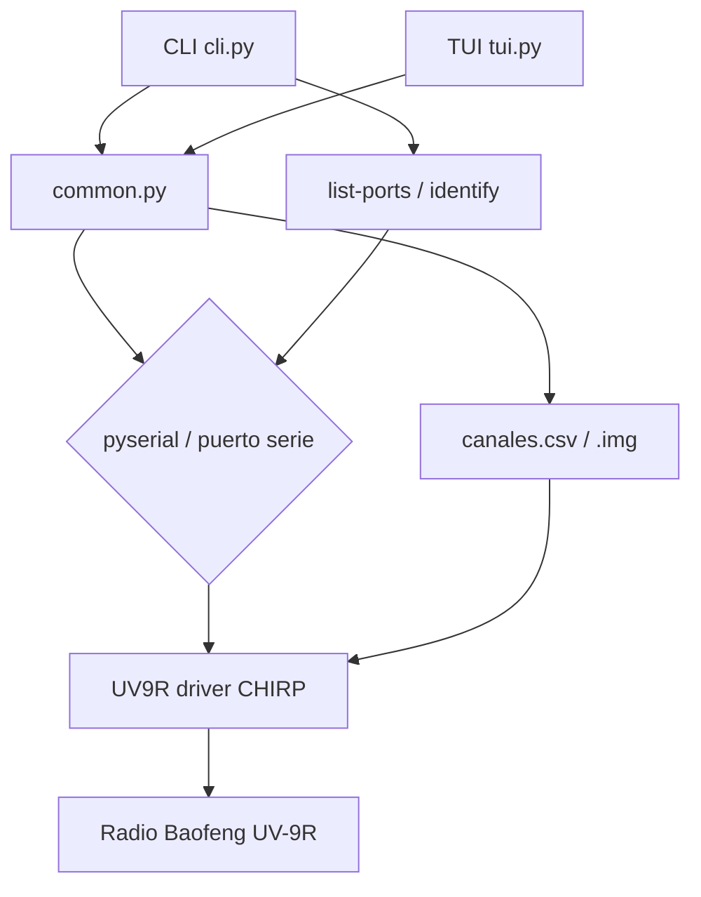

# baofeng-autoconfig

Programador CLI y TUI para radios Baofeng UV-9R usando los drivers CHIRP. Permite detectar el cable, descargar, subir, listar, verificar y convertir canales desde/hacia la radio a través de CSV o imágenes CHIRP `.img`.

[](https://python.org)
[](LICENSE)

## Contenido

- [Características](#características)
- [Arquitectura](#arquitectura)
- [Stack](#stack)
- [Estructura del repositorio](#estructura-del-repositorio)
- [Instalación](#instalación)
- [Uso](#uso)
- [Formato CSV](#formato-csv)
- [Tests](#tests)
- [Roadmap](#roadmap)
- [Licencia](#licencia)

## Características

- Interfaz dual: línea de comandos (`cli.py`) y TUI con Textual (`tui.py`).
- Auto-detección del puerto serie probando el "magic" en `/dev/ttyUSB*` y `/dev/ttyACM*`.
- Power-cycling asistido para entrar la radio en modo programación (se indica cuándo encenderla).
- Descarga de canales desde la radio a imagen `.img`.
- Subida de canales desde imagen `.img` o CSV a la radio.
- Listado de canales desde la radio o desde un archivo `.img`.
- Verificación de los canales de la radio contra un CSV de referencia.
- Conversión CSV -> imagen CHIRP (`csv2img`).
- Respaldo implícito: la imagen base se guarda en `img/uv9r_backup.img`.
- Barra de progreso en tiempo real durante las operaciones.

## Arquitectura



El flujo normal: se detecta el puerto, se configura el driver `UV9R` de CHIRP sobre el puerto serie, y las órdenes (`download`, `upload`, `list`, `verify`, `csv2img`) convierten entre la radio, los archivos `.img` y el CSV.

## Stack

| Componente | Tecnología |
|---|---|
| Lenguaje | Python 3.11+ |
| Drivers de radio | CHIRP (`chirp.drivers.baofeng_wp970i.UV9R`) |
| Comunicación serie | pyserial >= 3.5 |
| TUI | textual >= 0.50.0 |
| Testing | pytest |

## Estructura del repositorio

```
baofeng_autoconfig/
├── cli.py              # Interfaz de línea de comandos
├── tui.py              # Interfaz TUI (Textual)
├── common.py           # Utilidades compartidas (puerto, CSV, power levels)
├── canales.csv         # CSV de ejemplo con canales
├── img/
│   └── uv9r_backup.img # Imagen base de respaldo
├── tests/
│   └── test_common.py
├── requirements.txt
├── LICENSE
└── README.md
```

## Instalación

```bash
git clone https://github.com/bi0punk/baofeng_autoconfig.git
cd baofeng_autoconfig
pip install -r requirements.txt
```

CHIRP es una dependencia de sistema. En Debian/Ubuntu:

```bash
sudo apt install chirp
```

## Uso

Sin argumentos, `cli.py` abre la TUI. Con un subcomando, usa la CLI:

```bash
# Listar puertos serie disponibles
python cli.py list-ports

# Identificar la radio (test de conexion)
python cli.py identify

# Descargar canales de la radio a una imagen .img
python cli.py download

# Subir canales desde una imagen .img a la radio
python cli.py upload --img img/uv9r_backup.img

# Listar canales desde un archivo .img (sin radio)
python cli.py list --img img/uv9r_backup.img

# Verificar canales de la radio contra un CSV
python cli.py verify --csv canales.csv

# Convertir CSV a imagen CHIRP
python cli.py csv2img --csv canales.csv -o salida.img
```

El puerto se auto-detecta; se puede forzar con `--port`:

```bash
python cli.py --port /dev/ttyUSB1 download
```

En la TUI:

```bash
python tui.py
```

Las teclas de acción permiten descargar, subir, importar/exportar CSV, editar y agregar canales, verificar y guardar/abrir imágenes.

## Formato CSV

```csv
Location,Name,Frequency,Duplex,Offset,Tone,rToneFreq,cToneFreq,Mode,Power,Skip
1,Radio Uno,145.500,,0.6,,88.5,88.5,FM,5,
2,Radio Dos,146.000,-,0.6,Tone,88.5,88.5,FM,1,
```

| Columna | Descripción | Valores |
|---------|-------------|--------|
| Location | Número de canal (1-128) | Entero |
| Name | Nombre del canal | Texto |
| Frequency | Frecuencia en MHz | Float |
| Duplex | Modo duplex | `""`, `-`, `+`, `split` |
| Offset | Offset en MHz | Float |
| Tone | Modo de tono | `""`, `Tone`, `TSQL`, `DTCS`, `Cross` |
| rToneFreq | Frecuencia RX CTCSS | Float (ej: 88.5) |
| cToneFreq | Frecuencia TX CTCSS | Float |
| Mode | Modulación | `FM`, `NFM` |
| Power | Potencia en watts | `1`, `3`, `5` |
| Skip | Saltar canal | `""` o `S` |

## Tests

```bash
pip install pytest
pytest tests/ -v
```

Los tests verifican el mapeo de potencia del CSV y la conversión segura de floats en `common.py`.

## Roadmap

- [x] Programación por CLI
- [ ] Tests sobre el flujo de radio simulado (crear/modificar/leer memorias sin hardware)
- [ ] Soporte de más modelos de radios con drivers CHIRP compatibles

## Licencia

MIT — ver [LICENSE](LICENSE).